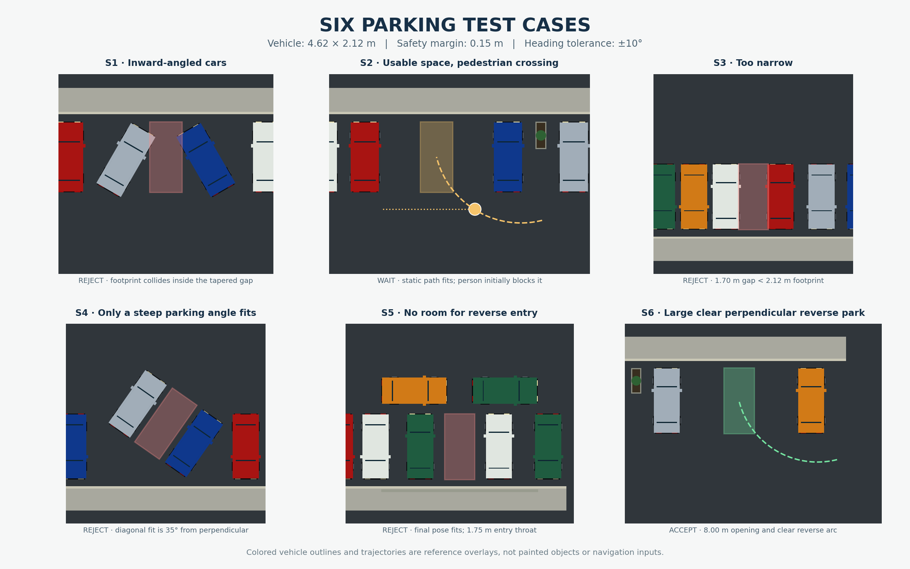

# Parking assessment scenarios — Gazebo Harmonic / ROS 2 Jazzy

An unmarked parking lot with 47 parked sedans, six controlled test cases,
one walking person, and an enlarged **AgileX LIMO** in Ackermann mode. The
body and wheel meshes come from the official `agilexrobotics/limo_ros2`
`humble` repository. Their proportions and materials are preserved.

The robot is uniformly enlarged to a **2.12 m straight-ahead width**; its body
length is approximately **3.00 m**, wheelbase **1.865 m**, and wheel radius
**0.449 m**. The steered-wheel conservative envelope is wider (2.56 m).
The SDF, dynamics, collisions, sensors and ROS frames are project adaptations
for Jazzy/Harmonic, not an official AgileX Jazzy release.

The walker crosses the red bay mouth between its two parked cars and stays
inside the opening. The parking mission uses a 360-degree LiDAR and two
near-ground range scanners.

The table describes the current world. The reference path CSVs and the
overview illustration come from the earlier layout and vehicle. Use
`config/limo.json` for the current vehicle dimensions.



Colored vehicles, labels and dashed paths in this drawing are evaluation
overlays. The actual world has no painted parking lines or target markers.

| Case | What the robot encounters | Expected decision |
| --- | --- | --- |
| S1 (green) | A 6.28 m opening between straight boundary cars for a perpendicular reverse park | Accept |
| S2 (yellow) | Two cars angled inward; the gap narrows around the final footprint | Reject |
| S3 | A 1.70 m opening, narrower than the vehicle | Reject |
| S4 | A diagonal fit 35° away from perpendicular; allowed error is ±10° | Reject |
| S5 | Final placement fits, but opposing cars leave a 1.75 m entry throat | Reject |
| S6 (red) | One pedestrian crosses the bay mouth between the two parked cars | Leave the space while the pedestrian blocks entry |

## Autonomous parking

In Ubuntu, from this `parking_lot_sim` folder, close any older Gazebo/control
session and run:

```bash
bash run_autonomous.sh
```

The default run starts at the entrance with the red-bay pedestrian enabled.
It completes a mapping circuit, returns to the start, then leaves again to
inspect the white, blue, red, yellow and green regions in order. It proposes
perpendicular targets using sensed boundaries and uses a full swept-footprint
audit before reverse entry. It verifies the final pose at standstill.

- `bash run_autonomous.sh pedestrians:=false` runs the same entrance mission in a static scene.
- `bash run_autonomous.sh scenario:=S6 pedestrians:=false` starts near the north-side test area.
- `bash run_autonomous.sh gui:=false rviz:=false` runs the simulation without GUI windows.

See [Autonomous parking](docs/AUTONOMOUS_PARKING.md) for implementation,
outputs and evidence. The prior survey-and-return workflow is available via
`ros2 launch launch/autonomous_mapping.launch.py` after sourcing ROS.

## Open the world

Extract the ZIP. In a terminal inside the extracted `parking_lot_sim` folder:

```bash
source /opt/ros/jazzy/setup.bash
bash run.sh
```

Start the robot near one case, for example the clear reverse-parking case:

```bash
bash run.sh S1
```

Replace `S1` with `S2` through `S6` for another starting condition. All cases
remain in the same lot; only the initial robot pose changes. Run one world
at a time. The bundled pedestrian models need no online downloads; `run.sh`
sets their resource path. Keep the extracted folder intact.

## Launch with ROS controls and sensor topics

Place the package directly in `~/ros2_ws/src/parking_lot_sim`, then:

```bash
cd ~/ros2_ws
source /opt/ros/jazzy/setup.bash
colcon build --packages-select parking_lot_sim --symlink-install
source install/setup.bash
ros2 launch parking_lot_sim parking_lot.launch.py
```

To start near a chosen case:

```bash
ros2 launch parking_lot_sim parking_lot.launch.py scenario:=S6
```

In another terminal:

```bash
source /opt/ros/jazzy/setup.bash
source ~/ros2_ws/install/setup.bash
ros2 run parking_lot_sim teleop_robot
```

W/S drive forward/reverse. A/D drive forward while steering left/right.
Z/C reverse while steering left/right. Space/X stops; Q exits. The keyboard
script stops issuing movement after 0.4 seconds without input. This is manual
control; the package does not autonomously detect spaces or park the vehicle.

The ROS launch bridges controls, LiDAR, RGB images, IMU, wheel odometry,
wheel/steering joints, bumper contacts, TF and simulation time. See
[Robot and people](docs/ROBOT_AND_PEDESTRIANS.md) for topic names.

If dependencies are missing, on a machine with the Jazzy apt repository:

```bash
sudo apt update
sudo apt install ros-jazzy-ros-gz ros-jazzy-robot-state-publisher python3-colcon-common-extensions
```

This package targets Gazebo Harmonic (`gz sim`), rather than Gazebo Classic.

## Build a map with the existing world

Keep Gazebo open and stop the previous standalone ROS/Gazebo bridge. From
the source `parking_lot_sim` directory, run:

```bash
source /opt/ros/jazzy/setup.bash
ros2 launch launch/mapping.launch.py
```

This starts laser mapping and RViz alongside the existing world. Keep using
`python3 scripts/teleop_robot.py` in another terminal to drive through clear
aisles. The map is built from sensor observations and wheel odometry. See
[Mapping](docs/MAPPING.md) for display colours, dependencies, frame ownership,
map saving and options for use with the complete ROS world launch.

## Checks and evaluation references

```bash
python3 scripts/validate_world.py
```

This checks the supplied scenery, local resources, robot joints and sensors.
`parking_scenarios.json` records the current scene. The earlier reference
CSV files are retained for comparison. `validate_scenarios.py` checks the
current LIMO footprint against the fixed target poses. A driven run measures
execution and final parking accuracy.

See `config/limo.json` for the robot's dimensions. The documented 0.15 m safety
margin, heading tolerances and reference cases can be used when a new
LIMO-specific evaluation is implemented. Keep all simulator ground-truth files
separate from sensor-based mapping and space detection.

## Generate earlier layouts

```bash
# Generate the earlier controlled layout and six case starts in a separate folder
python3 scripts/generate_world.py --output-dir /tmp/original_parking
python3 scripts/validate_world.py /tmp/original_parking

# Previous random layout, now using the same car-sized steering robot
python3 scripts/generate_world.py --layout random --seed 24 --output-dir /tmp/random_parking
GZ_SIM_RESOURCE_PATH=/tmp/random_parking/models gz sim -r /tmp/random_parking/worlds/parking_lot.sdf

# Static version of the earlier controlled layout
python3 scripts/generate_world.py --no-pedestrians --output-dir /tmp/static_parking
gz sim -r /tmp/static_parking/worlds/parking_lot.sdf
```

The current controlled layout is in the supplied SDFs and scene metadata.
The generator uses the earlier layout in `scripts/scene_scenarios.py`.
Use a separate output directory to preserve the supplied worlds.

For fresh previews after editing (optional numpy and matplotlib required):

```bash
python3 scripts/render_preview.py
python3 scripts/render_people_preview.py
```

## Verification limits

The LIMO resource files, positive inertias, four driven wheel joints, steering
joints, sensor definitions and matching SDF/URDF transforms are statically checked.
The supplied worlds share the same test scenery and differ by the robot's
starting pose across case variants. Earlier runs and reference manoeuvres are
documented in the [validation record](docs/VALIDATION.md).

The original scene, pedestrian geometry/animation and project source retain
the included MIT license. The added LIMO resources are vendor assets; see
`models/limo/README.md` for provenance and upstream licensing information.
