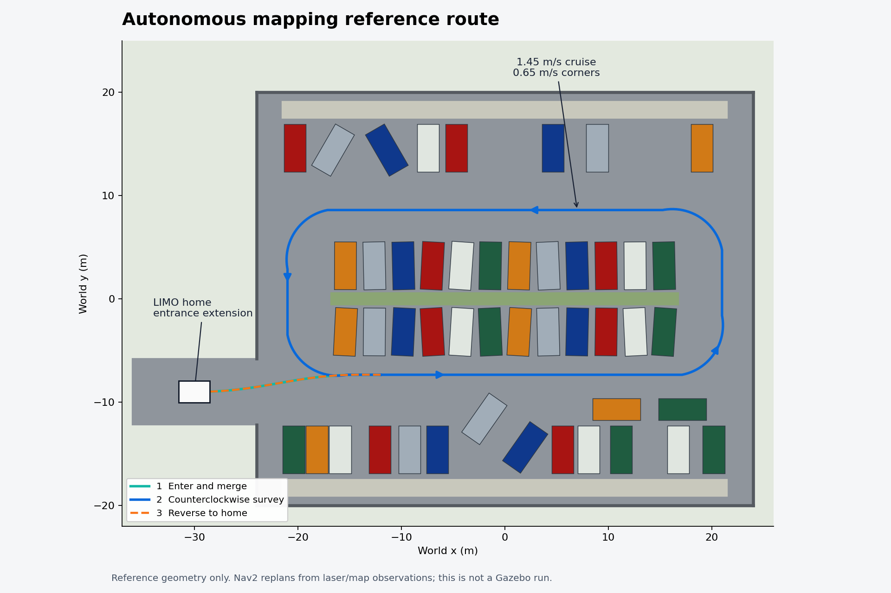

# Autonomous survey and mapping

Updated 2026-11-19: the coordinator no longer overwrites `rclpy.Node.handle`.
Pending action replies are invalidated and late accepted goals cancelled on
mission changes. Rejected goals and unanswered requests stop driving and
retry after a delay. A stale map holds the vehicle, and the final target
remains enabled until its positional tolerance is met. Map-saver startup
errors and timeouts are reported. The entry script checks dependencies before
launching; exits of the mission, velocity guard or Nav2 servers shut down the
simulation. These changes pass offline regression tests; a live run is still
required.

Version 0.4.2 addresses the reported entrance-map deadlock. `map_support.py`
publishes `/navigation_map` by adding 4 m of unknown cells around `/map`.
Every original occupancy value and world position is preserved; this is not
a loaded scene map or synthetic free space. The coordinator and global
static layer both consume this padded grid. `/map` remains the SLAM output
and map-saver input. The default RViz display uses a sampled colored point
cloud (`/map_preview`) to bypass the reported indexed-texture shader error;
sampling affects only display. The inflation layer now covers the complete
rear-axle footprint's circumscribed radius.

Version 0.4.3 addresses the reported reverse start. Entry and survey use a
forward-only DUBIN planner with RPP reversing disabled. Only after the survey
and a full stop does the coordinator request REEDS_SHEPP and enable RPP
reversing for return, using the existing single planner. Both ROS parameter
services must acknowledge success before motion is authorized. Failure or
timeout holds the vehicle. A separate direction heartbeat makes the final
velocity publisher reject reverse commands during survey and forward commands
during return. Old commands are discarded on a direction change. Inflation
decay is 1.0, matching the controller's cost-distance conversion and avoiding
zero quantization at the outer footprint radius. All 37 offline tests pass;
revised live navigation and physical driving direction still need verification.

## Start

Close the old Gazebo instance and stop the old bridge, keyboard controller,
mapping launch and topic-echo processes with Ctrl+C. Run one complete world
at a time. In Ubuntu, from this project's `parking_lot_sim` directory:

```bash
bash run_autonomous.sh
```

The launcher starts Gazebo, its ROS bridge and clock, robot transforms,
slam_toolbox, RViz, Nav2, the survey coordinator and the final velocity guard.
There is no keyboard-driving step. Once a map, current transforms and the
navigation action server are available, the robot starts moving by itself.
Ctrl+C in this terminal stops the launch. Closing Gazebo also stops it.

If the required navigation packages are missing, install them in Ubuntu:

```bash
sudo apt update
sudo apt install ros-jazzy-navigation2 ros-jazzy-slam-toolbox ros-jazzy-rviz2 ros-jazzy-robot-state-publisher
```

No compilation is required for the source-tree launch. To open the entire
scene and navigation system without automatically starting the mission:

```bash
bash run_autonomous.sh autostart:=false
```

## Mission

The default robot now starts at **(-30, -9) m, heading 0 degrees**, centred
in the existing projecting entrance road. Its pose is in `parking_lot.json`
and both overview world files. The S1-S6 diagnostic worlds intentionally
retain their individual case starts; the autonomous launcher uses the
overview world.

The mission is an entry merge, a counterclockwise aisle circuit with four
rounded left corners, and a reverse return along the entry branch. A branch
road is not part of a closed rectangle: reversing along it is needed to end
at the original pose facing into the lot. The car does not rotate in place.



The reference uses rear-axle arcs of radius **4.8 m**. It is a manually
specified inspection route, not an autonomous exploration or parking-space
discovery algorithm. Its coordinates in `patrol.json` are relative to the
initial robot pose, anchored using the first SLAM transform. Neither the
coordinator nor navigation loads parked-car poses, actor routes, case labels,
reference parking paths or `scene_ground_truth.json`. That file is used only
by the offline route validator and drawing script.

The coordinator sends nearby goals about 8 m ahead and refreshes them after
about 2.5 m of progress. It clips targets to the padded navigation map
bounds, including the whole padded footprint, so a distant unbuilt map does
not prevent the first navigation goal. Unknown cells are allowed in global
planning; incoming scans populate the local obstacle layer before driving.

## Driving and obstacles

Nav2's **Smac Hybrid-A*** planner generates paths using a car-like motion
model with a **4.6 m minimum rear-axle turning radius**. Entry and survey use
forward-only DUBIN; the stopped return phase switches to REEDS_SHEPP.
**Regulated Pure Pursuit** tracks them, reduces speed at corners
and obstacles, and checks its projected footprint for collisions. Global
replanning runs at 1 Hz; the local laser costmap updates at 8 Hz. If no safe
path can be produced, the behavior tree waits and retries. Its recovery
tree contains no spin-in-place behavior.

This provides steering detours where the sensed free space allows them,
and stopping/waiting where it does not. It does not promise passage through
a blocked aisle. The actual path can depart from the blue survey reference.

Navigation uses the added `rear_axle` TF frame, rather than treating the
vehicle's midpoint as a differential-drive rotation centre. Its footprint
includes the official model's length, the conservative steered-wheel width,
the body-centre offset, and 0.12 m padding on every side. This is the same
frame and envelope used in the reference-path geometry check.
Wheel odometry also publishes `odom` to `rear_axle`; the first driven joint
on each side is now the rear wheel used for odometry. The URDF then publishes
`rear_axle` to `base_footprint` and the body/sensor frames. This keeps the
odometry, planner, steering model and sensor transforms in the same reference.

| Setting | Speed |
| --- | --- |
| Straight cruise ceiling | 1.45 m/s |
| Nominal 4.8 m corner | approximately 0.65 m/s |
| Reverse return ceiling | 0.40 m/s |
| Walking actors (distance divided by scheduled leg duration) | 1.10–1.30 m/s |

These are requested ceilings, not guaranteed travel speeds. Acceleration,
obstacles, corner curvature, map cost and goal approach can reduce them.
The Gazebo Ackermann system's forward velocity limit is 1.45 m/s.

Only `drive_guard.py` publishes final `/cmd_vel` during autonomous operation.
It holds the car until the mission enables driving, stops commands if the
mission heartbeat, navigation command, scan or odometry becomes stale,
or the direction heartbeat becomes stale or disagrees with the command sign,
limits forward/reverse speed, caps yaw rate by the steering constraint, and
ramps acceleration while preserving curvature. Do not run the keyboard
publisher at the same time.

## Display and output

RViz is the viewer; slam_toolbox builds the map. Red points are current
laser returns. The cyan line is the reference survey; the green line is
Nav2's current obstacle-aware plan. The map begins with observations from
the entrance and expands while the car moves. Black cells indicate
obstacles, white cells observed free space, and grey cells unknown space.

After completing the loop and reverse return, the coordinator disables
driving, waits three simulation seconds for a map update, and invokes the
map saver. Its success or failure is printed explicitly. Successful output:

```text
maps/parking_lot.pgm
maps/parking_lot.yaml
```

These store the occupancy grid, not a resumable SLAM pose graph. Leaving the
launch running keeps the live mapping system available for inspection.

## Evidence and limits

Offline tests cover continuity, forward/reverse joins, rear-axle kinematics,
steering curvature, the complete swept padded vehicle rectangle against all
47 cars and the supplied curb/wall/planter geometry, progress through the
closed loop, velocity clipping and rear-axle footprint consistency. The
adjusted lower aisle avoids the S4 diagonal car without moving any scenery.
Non-robot XML in all eight world files remains identical to the earlier
LIMO scene. The original meshes, car positions and pedestrian routes remain.

The nominal path is approximately 144.4 m including entry and reverse return.
Planning, acceleration, obstacle waiting and simulation real-time factor
affect elapsed time.

The live ROS/Nav2/Gazebo run has not been executed from the Windows editing
session. Offline path clearance does not establish live localisation,
traction, sensor visibility, obstacle avoidance or successful completion.
The existing horizontal laser can miss low curbs or walls below its scan
height, and moving actors are visual/sensor obstacles rather than physical
collision bodies. These are relevant limits of the supplied scene and need
to be considered when inspecting the live map and navigation. Grid cell
size and fixed padding do not quantify map uncertainty or certify tight
parking manoeuvres. This change adds autonomous survey mapping, not parking
space selection or autonomous parking.

Run the offline checks from the project directory:

```bash
python3 -m unittest discover -s tests -v
python3 scripts/validate_world.py
```

## Primary references

- [Smac Hybrid-A*](https://docs.nav2.org/jazzy/configuration_and_development/configuration_guide/planners_plugins/smac/smac_hybrid/configuring_smac_hybrid/)
- [Regulated Pure Pursuit](https://docs.nav2.org/jazzy/configuration_and_development/configuration_guide/controller_plugins/configuring_regulated_pp/)
- [Controller server](https://docs.nav2.org/jazzy/configuration_and_development/configuration_guide/core_servers/controller_server/)
