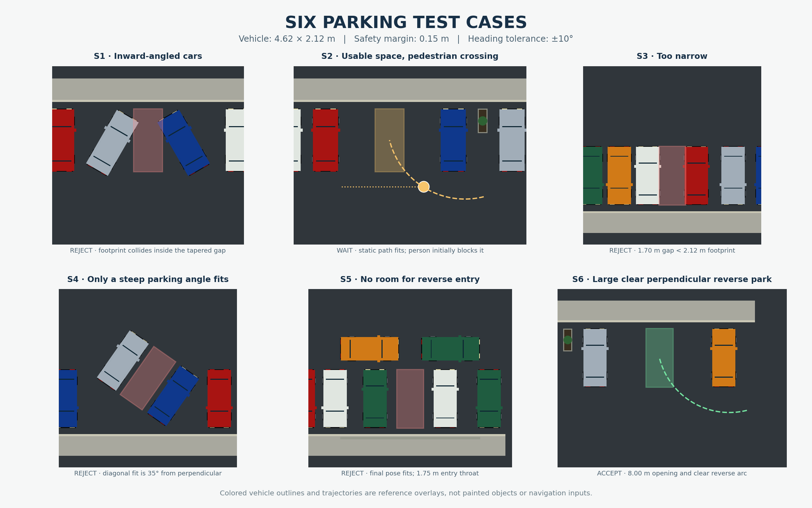

# Parking assessment scenarios — Gazebo Harmonic / ROS 2 Jazzy

An unmarked parking lot with **47 parked sedans**, **six controlled test cases**,
six walking people, and a **car-sized four-wheel-drive robot**. The robot's
4.62 × 2.12 m footprint matches the parked sedan envelope, including bumpers
and mirrors. The robot remains a low sensor platform; its height is lower than
a sedan. It uses front Ackermann steering and cannot turn in place.



Colored vehicles, labels and dashed paths in this drawing are evaluation
overlays. The actual world has no painted parking lines or target markers.

| Case | What the robot encounters | Expected decision |
| --- | --- | --- |
| S1 | Two cars angled inward; the gap narrows around the final footprint | Reject |
| S2 | A geometrically usable space and reverse path, with a pedestrian crossing the swept path | Wait while blocked, then reassess |
| S3 | A 1.70 m opening, narrower than the vehicle | Reject |
| S4 | A diagonal fit 35° away from perpendicular; allowed error is ±10° | Reject |
| S5 | Final placement fits, but opposing cars leave a 1.75 m entry throat | Reject |
| S6 | An 8.00 m opening with a clear reverse arc ending perpendicular to the curb | Accept |

**S6 is the only immediately clear accepted case at the initial snapshot.**
S2 must become eligible once its pedestrian genuinely clears the planned path;
it is not a permanently bad parking space. The ordinary driving aisles and
the road outside the entrance are not parking targets.

## Open the world

Extract the ZIP. In a terminal inside the extracted `parking_lot_sim` folder:

```bash
source /opt/ros/jazzy/setup.bash
bash run.sh
```

Start the robot near one case, for example the clear reverse-parking case:

```bash
bash run.sh S6
```

Replace `S6` with `S1` through `S5` for another starting condition. All cases
remain in the same lot; only the initial robot pose changes. Run one world
at a time. The bundled pedestrian models need no online downloads; `run.sh`
sets their resource path. Keep the extracted folder intact.

## Launch with ROS controls and sensor topics

Place the package directly in `~/ros2_ws/src/parking_lot_sim`, then:

```bash
cd ~/ros2_ws
source /opt/ros/jazzy/setup.bash
colcon build --packages-select parking_lot_sim --symlink-install
source install/setup.bash
ros2 launch parking_lot_sim parking_lot.launch.py
```

To start near a chosen case:

```bash
ros2 launch parking_lot_sim parking_lot.launch.py scenario:=S6
```

In another terminal:

```bash
source /opt/ros/jazzy/setup.bash
source ~/ros2_ws/install/setup.bash
ros2 run parking_lot_sim teleop_robot
```

W/S drive forward/reverse. A/D drive forward while steering left/right.
Z/C reverse while steering left/right. Space/X stops; Q exits. The keyboard
script stops issuing movement after 0.4 seconds without input. This is manual
control; the package does not autonomously detect spaces or park the vehicle.

The ROS launch bridges controls, LiDAR, RGB images, IMU, wheel odometry,
wheel/steering joints, bumper contacts, TF and simulation time. See
[Robot and people](docs/ROBOT_AND_PEDESTRIANS.md) for topic names.

If dependencies are missing, on a machine with the Jazzy apt repository:

```bash
sudo apt update
sudo apt install ros-jazzy-ros-gz ros-jazzy-robot-state-publisher python3-colcon-common-extensions
```

This package targets Gazebo Harmonic (`gz sim`), rather than Gazebo Classic.

## Scenario checks and offline scoring

```bash
python3 scripts/validate_scenarios.py

# A correct final world pose in the clear space
python3 scripts/evaluate_parking_pose.py S6 --x 14 --y 14.6 --yaw-deg -90

# Same position, but 35 degrees away from perpendicular: rejected
python3 scripts/evaluate_parking_pose.py S6 --x 14 --y 14.6 --yaw-deg -55
```

The evaluator uses a 0.15 m footprint safety margin, ±10° heading tolerance
and 0.50 m final position tolerance. It is for independent evaluation of
recorded **world poses**, not a navigation input or complete manoeuvre judge.
Dynamic motion, pedestrian proximity, contact history and tracking error still
need to be checked during each run.

`config/parking_scenarios.json` contains case labels and reference goals.
`config/reference_paths/S2_reverse.csv` and `S6_reverse.csv` contain independent
kinematic reverse-path examples. Do not pass this simulator ground truth into
your robot's mapping, space detection or selection algorithm. The robot should
infer the scene from its sensors.

See [Scenario geometry and evaluation](docs/SCENARIOS.md) for the geometry,
the blocked-entry certificate, reference-path assumptions and dynamic caveat.

## Edit and regenerate

```bash
# Regenerate the supplied controlled layout and six case starts
python3 scripts/generate_world.py
python3 scripts/validate_scenarios.py

# Previous random layout, now using the same car-sized steering robot
python3 scripts/generate_world.py --layout random --seed 24 --output-dir /tmp/random_parking
GZ_SIM_RESOURCE_PATH=/tmp/random_parking/models gz sim -r /tmp/random_parking/worlds/parking_lot.sdf

# Static controlled layout; S2 also becomes usable when people are disabled
python3 scripts/generate_world.py --no-pedestrians --output-dir /tmp/static_parking
gz sim -r /tmp/static_parking/worlds/parking_lot.sdf
```

The controlled layout is specified in `scripts/scene_scenarios.py`. Case
geometry is intentional, so random angle/empty-bay options apply to the random
layout. Uniform `--scale` resizes the included robot, cars, people and ranges
together. Preserve car/robot size ratios when changing a case.

For fresh previews after editing (optional numpy and matplotlib required):

```bash
python3 scripts/render_preview.py
python3 scripts/render_people_preview.py
```

## Verification limits

The generator, XML, local assets, positive inertias, driven and steering joints,
sensor definitions, TF names, case starts and scenario geometry were checked.
The S2/S6 reference reverse arcs pass footprint, curb and steering-limit checks.
The S5 approach is enclosed for the chassis footprint even though the final
pose fits. Previews were inspected visually.

Gazebo/ROS are unavailable in the creation workspace. Live actor import,
vehicle tracking, traction, sensors and ROS bridge operation remain untested
here. No reference trajectory has been driven in Gazebo. See
[Validation record](docs/VALIDATION.md).

All scenery, pedestrian meshes and animation data are original generated
geometry. Source and assets use the included MIT license.
